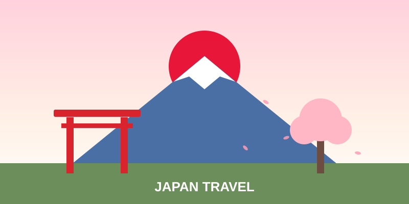

# 🗾 일본 여행 준비는 이렇게 하는겁니다.

*처음 가는 일본 여행도 막힘없이! 출발 전 체크리스트 모음*

---

## 📋 목차

1. [여행 전 필수 서류](#-1-여행-전-필수-서류)
2. [항공 · 숙소 예약](#-2-항공--숙소-예약)
3. [환전 · 결제](#-3-환전--결제)
4. [통신 · 앱](#-4-통신--앱)
5. [교통](#-5-교통)
6. [짐 싸기 체크리스트](#-6-짐-싸기-체크리스트)
7. [여행 팁](#-7-여행-팁)

---

## 🛂 1. 여행 전 필수 서류

- [ ] 여권 (유효기간 6개월 이상 남았는지 확인)
- [ ] 비자 여부 확인 (한국 여권 단기 관광은 무비자 입국 가능, 출발 전 공식 안내 재확인)
- [ ] Visit Japan Web 사전 등록 (입국 심사 · 세관 신고 QR)
- [ ] 여행자 보험 가입

## ✈️ 2. 항공 · 숙소 예약

- [ ] 항공권 예매 (출발/귀국 시간 및 수하물 규정 확인)
- [ ] 숙소 예약 (교통이 편한 역 근처 추천)
- [ ] 예약 확인서 캡처 또는 저장

## 💴 3. 환전 · 결제

- [ ] 엔화 환전 (일부 현금 필수, 소규모 가게/자판기용)
- [ ] 해외 결제 가능한 신용/체크카드 준비
- [ ] 모바일 결제(Apple Pay, Google Pay 등) 사용 가능 여부 확인

## 📱 4. 통신 · 앱

- [ ] eSIM / 유심 / 포켓와이파이 중 선택
- [ ] 추천 앱: 구글 지도, 파파고, 환승 안내 앱, 맛집 앱

## 🚄 5. 교통

- [ ] 교통 IC카드 준비 (스이카, 파스모 등)
- [ ] 지역별 패스 필요 여부 비교 (JR 패스, 지하철 1일권 등)
- [ ] 공항 ↔ 숙소 이동 경로 미리 확인

## 🧳 6. 짐 싸기 체크리스트

- [ ] 여권 · 지갑 · 휴대폰 · 충전기
- [ ] 멀티어댑터 (일본 전압 100V, 플러그 A형)
- [ ] 상비약 · 개인 위생용품
- [ ] 계절에 맞는 옷 (겹쳐 입기 좋은 옷)
- [ ] 편한 신발 (하루 2만 보 이상 걷는 경우 많음)
- [ ] 여분 비닐봉지 · 에코백 (일본은 쓰레기통이 적음)

## 💡 7. 여행 팁

- 일본은 **팁 문화가 없습니다.**
- 대중교통 안에서는 **통화를 삼가는** 것이 매너입니다.
- 면세(Tax-free) 혜택은 **여권 지참**이 필요합니다.
- 쓰레기는 가지고 다니다가 숙소나 지정 장소에서 버리세요.

---

